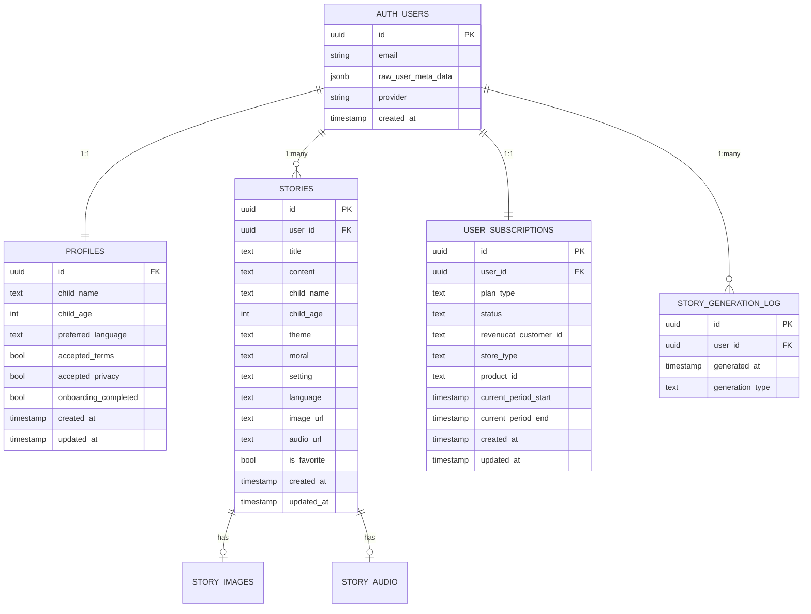

# User Data Inventory — Noctis AI

> [!IMPORTANT]
> This audit covers **all** user data collected, stored, or transmitted by the app and its SDKs, as found in the codebase as of 2026-11-08.

---

## 1. Directly Collected User Data

| #   | Data                                                            | Collected In                                                                                                                                                                                                                 | Stored / Sent To                                                                                                                       | Linked to Identity |
| --- | --------------------------------------------------------------- | ---------------------------------------------------------------------------------------------------------------------------------------------------------------------------------------------------------------------------- | -------------------------------------------------------------------------------------------------------------------------------------- | ------------------ |
| 1   | **Email address**                                               | [`sign-in.tsx`](<file:///d:/.vscode/noctis-ai/app/(auth)/sign-in.tsx>) — text input → `signInWithOtp`                                                                                                                        | Supabase Auth (`auth.users`)                                                                                                           | ✅ Yes             |
| 2   | **OTP code** (6-digit)                                          | [`verify-otp.tsx`](<file:///d:/.vscode/noctis-ai/app/(auth)/verify-otp.tsx>) — text input → `verifyOtp`                                                                                                                      | Supabase Auth (verified, not persisted)                                                                                                | ✅ Yes             |
| 3   | **Apple Identity Token + Auth Code**                            | [`appleAuth.ts`](file:///d:/.vscode/noctis-ai/lib/appleAuth.ts) via `expo-apple-authentication`                                                                                                                              | Apple servers → Supabase Auth (`signInWithIdToken`)                                                                                    | ✅ Yes             |
| 4   | **Apple user's email**                                          | [`appleAuth.ts`](file:///d:/.vscode/noctis-ai/lib/appleAuth.ts) — from Apple credential                                                                                                                                      | Supabase Auth (`auth.users`)                                                                                                           | ✅ Yes             |
| 5   | **Apple user's full name** (given + family, first sign-in only) | [`appleAuth.ts`](file:///d:/.vscode/noctis-ai/lib/appleAuth.ts) — `fullName.givenName/familyName`                                                                                                                            | Supabase Auth (user metadata)                                                                                                          | ✅ Yes             |
| 6   | **Apple user identifier**                                       | [`appleAuth.ts`](file:///d:/.vscode/noctis-ai/lib/appleAuth.ts) — `credential.user`                                                                                                                                          | Supabase Auth (provider ID)                                                                                                            | ✅ Yes             |
| 7   | **Google OAuth tokens** (ID token + access token)               | [`sign-in.tsx`](<file:///d:/.vscode/noctis-ai/app/(auth)/sign-in.tsx>) via `expo-auth-session`                                                                                                                               | Google servers → Supabase Auth (`signInWithIdToken`)                                                                                   | ✅ Yes             |
| 8   | **Child's name**                                                | [`onboarding.tsx`](<file:///d:/.vscode/noctis-ai/app/(auth)/onboarding.tsx>), [`settings.tsx`](<file:///d:/.vscode/noctis-ai/app/(tabs)/settings.tsx>), [`create.tsx`](<file:///d:/.vscode/noctis-ai/app/(tabs)/create.tsx>) | Supabase `profiles` table + `stories` table; sent to Google Gemini API in story prompt                                                 | ✅ Yes             |
| 9   | **Child's age** (1–12)                                          | [`onboarding.tsx`](<file:///d:/.vscode/noctis-ai/app/(auth)/onboarding.tsx>), [`settings.tsx`](<file:///d:/.vscode/noctis-ai/app/(tabs)/settings.tsx>), [`create.tsx`](<file:///d:/.vscode/noctis-ai/app/(tabs)/create.tsx>) | Supabase `profiles` + `stories` table; sent to Google Gemini API in story prompt                                                       | ✅ Yes             |
| 10  | **Preferred language**                                          | [`onboarding.tsx`](<file:///d:/.vscode/noctis-ai/app/(auth)/onboarding.tsx>), [`settings.tsx`](<file:///d:/.vscode/noctis-ai/app/(tabs)/settings.tsx>)                                                                       | Supabase `profiles` table; sent to Google Gemini API                                                                                   | ✅ Yes             |
| 11  | **Story theme**                                                 | [`create.tsx`](<file:///d:/.vscode/noctis-ai/app/(tabs)/create.tsx>) — selector                                                                                                                                              | Supabase `stories` table; sent to Google Gemini API                                                                                    | ✅ Yes             |
| 12  | **Story moral/lesson**                                          | [`create.tsx`](<file:///d:/.vscode/noctis-ai/app/(tabs)/create.tsx>) — selector                                                                                                                                              | Supabase `stories` table; sent to Google Gemini API                                                                                    | ✅ Yes             |
| 13  | **Story setting**                                               | [`create.tsx`](<file:///d:/.vscode/noctis-ai/app/(tabs)/create.tsx>) — selector                                                                                                                                              | Supabase `stories` table; sent to Google Gemini API                                                                                    | ✅ Yes             |
| 14  | **Terms of Service acceptance** (boolean)                       | [`onboarding.tsx`](<file:///d:/.vscode/noctis-ai/app/(auth)/onboarding.tsx>) — checkbox                                                                                                                                      | Supabase `profiles.accepted_terms`                                                                                                     | ✅ Yes             |
| 15  | **Privacy Policy acceptance** (boolean)                         | [`onboarding.tsx`](<file:///d:/.vscode/noctis-ai/app/(auth)/onboarding.tsx>) — checkbox                                                                                                                                      | Supabase `profiles.accepted_privacy`                                                                                                   | ✅ Yes             |
| 16  | **Story favorite toggle**                                       | [`library.tsx`](<file:///d:/.vscode/noctis-ai/app/(tabs)/library.tsx>), story detail screen                                                                                                                                  | Supabase `stories.is_favorite`                                                                                                         | ✅ Yes             |
| 17  | **Subscription plan selection**                                 | [`subscription.tsx`](<file:///d:/.vscode/noctis-ai/app/(tabs)/subscription.tsx>)                                                                                                                                             | RevenueCat SDK → Apple App Store / Google Play Store                                                                                   | ✅ Yes             |
| 18  | **Account deletion request**                                    | [`settings.tsx`](<file:///d:/.vscode/noctis-ai/app/(tabs)/settings.tsx>) — button                                                                                                                                            | Supabase Edge Function [`delete-account`](file:///d:/.vscode/noctis-ai/supabase/functions/delete-account/index.ts) (cascades all data) | ✅ Yes             |

---

## 2. Generated & Derived Data (Stored)

| #   | Data                                    | Generated In                                                                                                              | Stored In                                       | Linked to Identity |
| --- | --------------------------------------- | ------------------------------------------------------------------------------------------------------------------------- | ----------------------------------------------- | ------------------ |
| 19  | **Story text content**                  | [`gemini-generate-story`](file:///d:/.vscode/noctis-ai/supabase/functions/gemini-generate-story/index.ts) Edge Function   | Supabase `stories.content`                      | ✅ Yes             |
| 20  | **Story title**                         | [`gemini-generate-story`](file:///d:/.vscode/noctis-ai/supabase/functions/gemini-generate-story/index.ts) Edge Function   | Supabase `stories.title`                        | ✅ Yes             |
| 21  | **Story illustration images**           | [`gemini-generate-image`](file:///d:/.vscode/noctis-ai/supabase/functions/gemini-generate-image/index.ts) Edge Function   | Supabase Storage `story-images` bucket          | ✅ Yes             |
| 22  | **Story TTS audio**                     | [`gemini-generate-speech`](file:///d:/.vscode/noctis-ai/supabase/functions/gemini-generate-speech/index.ts) Edge Function | Supabase Storage `story-audio` bucket           | ✅ Yes             |
| 23  | **Story generation timestamps**         | [`planLimits.ts`](file:///d:/.vscode/noctis-ai/lib/planLimits.ts) / Supabase                                              | Supabase `story_generation_log`                 | ✅ Yes             |
| 24  | **Generation type** (story/image/audio) | Edge Functions                                                                                                            | Supabase `story_generation_log.generation_type` | ✅ Yes             |

---

## 3. Auth & Session Data

| #   | Data                                            | Managed By                                                                                            | Stored In                                                 | Linked to Identity |
| --- | ----------------------------------------------- | ----------------------------------------------------------------------------------------------------- | --------------------------------------------------------- | ------------------ |
| 25  | **Supabase access token**                       | `@supabase/supabase-js` via [`supabaseClient.ts`](file:///d:/.vscode/noctis-ai/lib/supabaseClient.ts) | Device (AsyncStorage / expo-secure-store) + Supabase Auth | ✅ Yes             |
| 26  | **Supabase refresh token**                      | `@supabase/supabase-js`                                                                               | Device (AsyncStorage / expo-secure-store) + Supabase Auth | ✅ Yes             |
| 27  | **Auth session state**                          | [`useAuthGuard.ts`](file:///d:/.vscode/noctis-ai/hooks/useAuthGuard.ts)                               | In-memory (React state)                                   | ✅ Yes             |
| 28  | **Cryptographic nonce** (for Apple/Google auth) | [`appleAuth.ts`](file:///d:/.vscode/noctis-ai/lib/appleAuth.ts) via `expo-crypto`                     | Ephemeral (sent to Apple + Supabase, not persisted)       | ❌ No              |

---

## 4. Subscription & Payment Data

| #   | Data                                               | Collected In                                                                                                                                                         | Stored / Sent To                                     | Linked to Identity |
| --- | -------------------------------------------------- | -------------------------------------------------------------------------------------------------------------------------------------------------------------------- | ---------------------------------------------------- | ------------------ |
| 29  | **Supabase User ID → RevenueCat appUserID**        | [`revenueCat.ts`](file:///d:/.vscode/noctis-ai/lib/revenueCat.ts) — `Purchases.logIn(userId)`                                                                        | RevenueCat servers                                   | ✅ Yes             |
| 30  | **Purchase/transaction history**                   | RevenueCat SDK (implicit)                                                                                                                                            | RevenueCat servers; Apple/Google receipt servers     | ✅ Yes             |
| 31  | **Subscription plan type**                         | [`revenueCat.ts`](file:///d:/.vscode/noctis-ai/lib/revenueCat.ts), [`sync-subscription`](file:///d:/.vscode/noctis-ai/supabase/functions/sync-subscription/index.ts) | Supabase `user_subscriptions.plan_type` + RevenueCat | ✅ Yes             |
| 32  | **Subscription status** (active/expired/cancelled) | [`sync-subscription`](file:///d:/.vscode/noctis-ai/supabase/functions/sync-subscription/index.ts)                                                                    | Supabase `user_subscriptions.status`                 | ✅ Yes             |
| 33  | **RevenueCat customer ID**                         | [`sync-subscription`](file:///d:/.vscode/noctis-ai/supabase/functions/sync-subscription/index.ts)                                                                    | Supabase `user_subscriptions.revenucat_customer_id`  | ✅ Yes             |
| 34  | **Store type** (app_store / play_store)            | [`sync-subscription`](file:///d:/.vscode/noctis-ai/supabase/functions/sync-subscription/index.ts)                                                                    | Supabase `user_subscriptions.store_type`             | ✅ Yes             |
| 35  | **Product ID**                                     | [`sync-subscription`](file:///d:/.vscode/noctis-ai/supabase/functions/sync-subscription/index.ts)                                                                    | Supabase `user_subscriptions.product_id`             | ✅ Yes             |
| 36  | **Subscription period dates** (start/end)          | [`sync-subscription`](file:///d:/.vscode/noctis-ai/supabase/functions/sync-subscription/index.ts)                                                                    | Supabase `user_subscriptions`                        | ✅ Yes             |
| 37  | **App Store / Play Store receipt data**            | RevenueCat SDK (implicit)                                                                                                                                            | RevenueCat → Apple / Google servers                  | ✅ Yes             |

---

## 5. Implicitly Collected by SDKs

| #   | Data                                             | SDK                                                   | Sent To                      | Linked to Identity  |
| --- | ------------------------------------------------ | ----------------------------------------------------- | ---------------------------- | ------------------- |
| 38  | **Device platform** (iOS/Android)                | RevenueCat SDK                                        | RevenueCat servers           | ✅ Yes              |
| 39  | **OS version**                                   | RevenueCat SDK                                        | RevenueCat servers           | ✅ Yes              |
| 40  | **App version**                                  | RevenueCat SDK                                        | RevenueCat servers           | ✅ Yes              |
| 41  | **Device model**                                 | RevenueCat SDK                                        | RevenueCat servers           | ✅ Yes              |
| 42  | **Device locale / language**                     | RevenueCat SDK                                        | RevenueCat servers           | ✅ Yes              |
| 43  | **IP address** (inferred geo-location)           | RevenueCat SDK, Supabase, Google Gemini (server-side) | RevenueCat, Supabase, Google | ✅ Yes              |
| 44  | **IDFA / GAID** (advertising ID, if ATT granted) | RevenueCat SDK (if permission granted)                | RevenueCat servers           | ✅ Yes (if present) |
| 45  | **Expo device/project registration**             | Expo SDK (dev builds only)                            | Expo servers                 | ❌ No (dev only)    |

---

## 6. Data Flow Summary by Third Party

| Third Party                                   | Data Received                                                                                                                                        | Purpose                                      |
| --------------------------------------------- | ---------------------------------------------------------------------------------------------------------------------------------------------------- | -------------------------------------------- |
| **Supabase** (auth + database + storage)      | Email, OAuth tokens, user profile (child name, age, language), all stories (text, images, audio), subscription data, generation logs, session tokens | Primary backend — all user data              |
| **Google Gemini API**                         | Child's name, child's age, story theme/moral/setting/language, story text (for TTS), image prompts                                                   | AI content generation (story, image, speech) |
| **RevenueCat**                                | Supabase user ID, purchase history, device info (platform, OS, model, locale, app version, IP), IDFA/GAID                                            | In-app purchase management                   |
| **Apple** (Sign in with Apple + App Store)    | Apple auth credentials, purchase receipts                                                                                                            | Authentication + payments                    |
| **Google** (Sign in with Google + Play Store) | Google OAuth credentials, purchase receipts                                                                                                          | Authentication + payments                    |
| **Expo** (dev builds only)                    | Device registration info                                                                                                                             | Development tooling                          |

---

## 7. Supabase Database Schema (All User-Linked Tables)

---

## 8. Key Privacy Observations

> [!WARNING]
> **Child data (COPPA/GDPR-K considerations):** The app collects a child's name and age (items #8–9) and sends them to Google Gemini in AI prompts. This data is stored in both the `profiles` and `stories` tables linked to the authenticated user. If the app targets children under 13, COPPA and GDPR-K (Article 8) compliance must be verified — particularly around parental consent and the transfer of child data to Google's API.

> [!NOTE]
> **No analytics or crash reporting SDKs** were found in the codebase — no Firebase Analytics, Sentry, Amplitude, Mixpanel, or similar. RevenueCat's built-in telemetry for purchase events is the only implicit analytics.

> [!TIP]
> **RLS is enabled** on all Supabase tables, ensuring users can only access their own data. The `delete-account` edge function performs a full cascade deletion of all user data across all tables and storage buckets.
